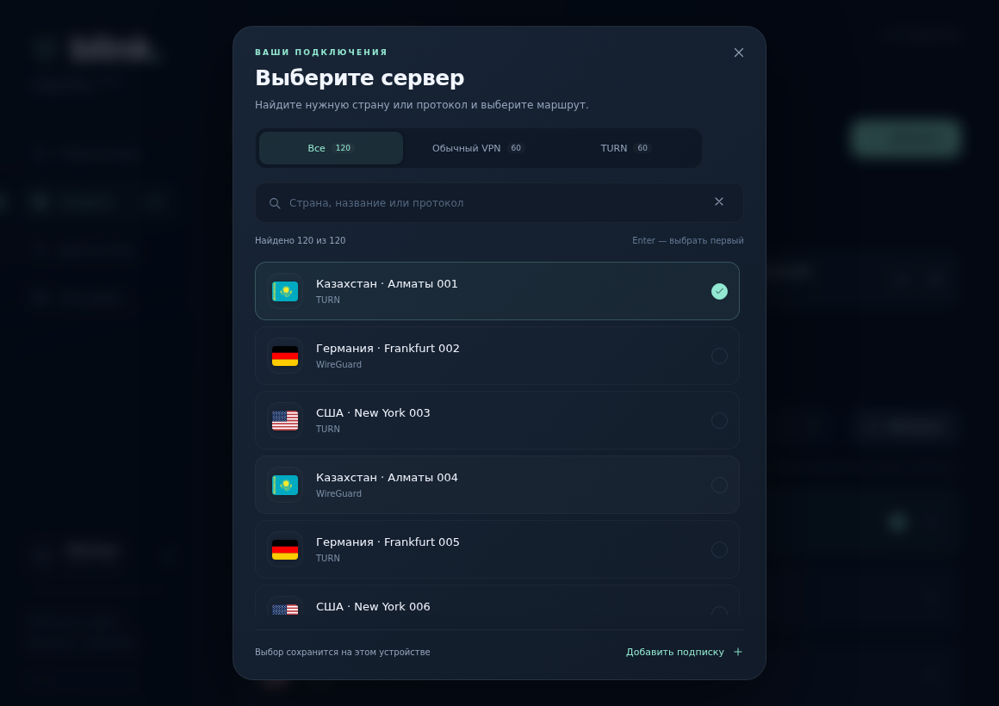
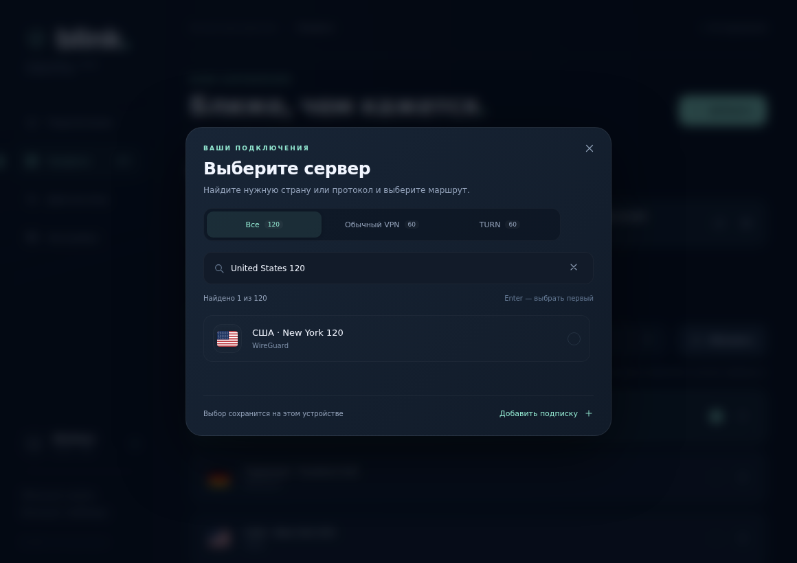
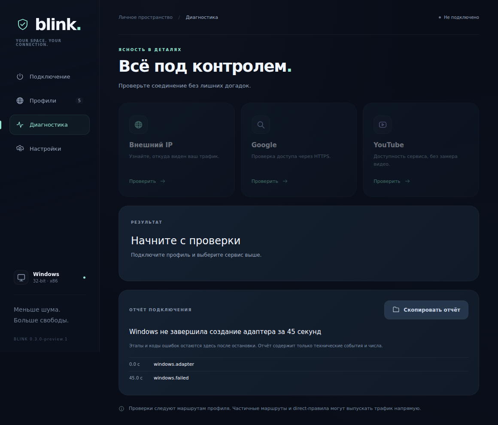

# Blink для Windows

Windows-клиент на общем Go-ядре [Blink iOS](https://github.com/remzone/blink_ios) и [Blink Android](https://github.com/remzone/blink-android). Xray, WireGuard/AmneziaWG, TURN, подписки Vokop и обычные VPN-профили.

**0.3.0-preview.1 — диагностическая версия.** Независимое хранение обычных VPN- и TURN-подписок, обновление каждого источника отдельно и сохранение выбора серверов. Запуск Windows разделён на этапы с отменой, тайм-аутами и локальным отчётом.

**Стабильных готовых сборок пока нет.** Архивы 0.2.x отозваны из текущей ветки: пользователи сообщили о зависании подключения в обоих режимах. Причина на целевом Windows не установлена; кросс-компиляция и тесты этого не заменяют.

**Для воспроизведения и диагностики:** [x64 preview](https://github.com/remzone/blink_windows/raw/refs/heads/main/testing/0.3.0-preview.1/Blink-Windows-0.3.0-preview.1-x64.zip) · [x86 preview, 32 бит](https://github.com/remzone/blink_windows/raw/refs/heads/main/testing/0.3.0-preview.1/Blink-Windows-0.3.0-preview.1-x86.zip) · [SHA256SUMS](testing/0.3.0-preview.1/SHA256SUMS)

Если проблема повторяется: откройте **Диагностика → Скопировать отчёт** после ошибки или отмены. Отчёт содержит этапы, фиксированные коды и числа; ссылки подписок, ключи, адреса серверов и трафик в него не включаются. Это локальная функция, автоматической отправки нет.

[Изменения](docs/CHANGELOG.md) · [Проверки и ограничения](docs/validation.md)


| Выбор из большой подписки | Поиск по стране и протоколу |
| --- | --- |
|  |  |




Превью встроенного интерфейса на синтетических профилях; это не свидетельство работы реального VPN. Графитовая палитра, мятный акцент, орбита подключения, карточки, клавиатурный фокус, уменьшение движения и компактная раскладка перенесены из визуального языка iOS/Android. Флаги рисуются встроенными векторами и не зависят от эмодзи-шрифта Windows.

## Установка

Требуются **Windows 10/11 x64** либо **Windows 10 x86**, права администратора и [Microsoft Edge WebView2 Runtime](https://developer.microsoft.com/en-us/microsoft-edge/webview2/). Windows 7/8 не поддерживаются. Windows 11 выпускается для 64-битных систем; x86-приложение также может запускаться в WOW64 на x64 Windows.

Диагностические ZIP находятся в `testing/0.3.0-preview.1`; они не заявлены как рабочий стабильный релиз. Исходники можно собрать по инструкции ниже; сведения о проверках Windows и ограничениях CI приведены в [validation.md](docs/validation.md).

1. Для проверки используйте диагностический ZIP своей архитектуры либо соберите EXE ниже. Предыдущие ZIP 0.2.x отозваны.
2. Распакуйте ZIP целиком. `Blink.exe` и `wintun.dll` должны лежать рядом.
3. Запустите EXE и подтвердите UAC для драйвера и настройки сети.
4. Откройте **Профили → Добавить**, вставьте HTTPS-подписку/конфигурацию или выберите файл.
5. После импорта откроется **Выберите сервер**: выберите вкладку, найдите страну или протокол, нажмите сервер. На главной нажмите **Подключиться**. Окно выбора можно открыть повторно кнопкой **Все серверы**. В **Диагностике** проверьте внешний IP, Google или YouTube.

Пакеты, созданные сборщиком, включают EXE и официальный Wintun 0.14.1 соответствующей архитектуры, лицензии и документацию. Сборщик проверяет SHA-256 Wintun; EXE Blink не подписан Authenticode. Кросс-компиляция не подтверждает работу VPN на Windows.

## Профили и подписки

Импортируются URI, plain/base64-подписки, Xray JSON/массивы, поддерживаемые узлы Clash YAML и WG/AWG `.conf`. Поддерживаются VLESS/REALITY, VMess, Trojan, Shadowsocks, Hysteria2, TUIC v5, Hysteria v1 и транспорты закреплённого Xray, включая XDRIVE через JSON. [Матрица и границы](docs/protocols.md).

Новая подписка добавляется к существующим. Повторный импорт той же HTTPS-ссылки заменяет только принадлежащие ей профили; остальные подписки и отдельные конфигурации сохраняются. При ошибке загрузки, парсинга или записи старое состояние не изменяется. Карточки «Ваши подписки» позволяют обновить или удалить конкретный источник. До 64 источников и 1024 профилей. На главной профили разделены на **Обычный VPN** и **TURN**; библиотека и окно выбора также имеют вкладку **Все**. Переключатель типа на главной выбирает настоящий профиль соответствующего типа, возвращает последний сохранённый выбор каждого типа, в том числе после перезапуска и блокируется при подключении. Если в подписке нет `vpn_profiles`, вкладка обычного VPN останется пустой: TURN-профиль не превращается в обычный VPN. Последний выбранный сервер сохраняется через DPAPI. Поиск работает по стране на русском/английском, ISO-коду, названию и протоколу, в выбранной вкладке или сразу по всем серверам. Сброс возвращает полный список. Вставленная в поиск ссылка переносится в отдельную форму импорта без автоматической загрузки. После успешного импорта старый запрос очищается и открывается выбор сервера; профиль можно выбрать или удалить, подписку — обновить после отключения. Загрузка ограничена 1 МиБ; HTTPS-перенаправления разрешены до пяти раз только в пределах исходного host/порта.

Vokop v1/v2/v3: срок, revision, VLESS/KCP/smux через TURN, WG через DTLS/SRTP/WRAP, правила панели и поддерживаемые `turn.options`. Для панели нужна scoped HTTPS-ссылка `/api/vokop/v1/subscriptions/TOKEN`, а не административный пароль. Обновление той же ссылки защищено от отката revision. Другую ссылку клиент считает другой подпиской.

Сохранившиеся данные 0.1–0.2 мигрируют автоматически в один источник. Подписку, ранее стёртую заменой общего списка, потребуется добавить повторно: восстановить уже удалённые реквизиты из нового формата невозможно. Профили, ключи, ссылка и настройки зашифрованы Windows DPAPI CurrentUser в `%APPDATA%\Blink\profiles.dpapi`. Они привязаны к Windows-пользователю; браузерный профиль интерфейса временный и очищается после завершения/при следующем запуске.

## Ручная проверка

Современная проверка открывается внутри приложения через закреплённый SDK ручного задания. Его код уже включён в EXE с лицензией и хешем, не скачивается с CDN при запуске. Проверяются origin/source сообщения, challenge ID, срок и одноразовая отправка результата. После ответа то же задание повторно не открывается; ожидание готовности ограничено 60 секундами.

Старый формат показывает HTTPS-изображение и поле кода. Отмена закрывает проверку и останавливает подключение. Маршруты VPN устанавливаются после готовности транспорта, поэтому проверка проходит по обычной сети. Нет автоматического решения, доступа к cookies системного браузера/поставщика транспорта или обхода сроков. Реальная ручная проверка на Windows остаётся отдельным тестом; проверка JS-моста с mock frame её не заменяет.

## Настройки

- **TURN:** параметры панели либо свои Auto/UDP/TCP, DNS до подключения, TURN host:port, количество соединений, KCP preset, MTU, pacing, окно, интервал и контроль перегрузки.
- **Маршрутизация:** наследование панели, весь трафик либо выбранные домены/IP; личные исключения имеют приоритет. Для режима «весь трафик с исключениями» формируется явная политика IPv4 «всё, кроме». Выборочные правила требуют Xray или стандартного WG; AWG extensions и TUIC/Hysteria v1 этим путём не поддерживаются.
- **Диагностика:** внешний IP, Google, YouTube; DNS, TCP, TLS и ожидание ответа. Это HTTPS-проверки, не ICMP и не замер скорости видео. Они следуют маршрутам профиля и могут выйти напрямую при частичных/direct-правилах.

## Этапы подключения и отчёт

Вместо общего ожидания UI показывает очистку прежних правил, создание Wintun, запуск ядра, готовность TURN и настройку сети. Общий запуск ограничен 45 секундами, отдельная команда настройки/очистки — 30 секундами, ожидание транспорта — 90 секундами. Ручное задание имеет собственный срок; после ответа ожидание готовности ограничено 60 секундами.

Отмена запуска возвращает управление интерфейсу. Синхронный вызов Windows драйвера нельзя принудительно прервать: если он ещё не завершился, повторный старт блокируется до очистки его запоздалого результата, чтобы старая операция не сняла правила новой. Отчёт сохраняется в памяти до следующей попытки. Успех настройки интерфейса сам по себе не подтверждает удалённый handshake или доступность интернета — используйте HTTPS-диагностику.

## IPv4, IPv6 и жизненный цикл

Xray/VLESS через TURN и выборочная маршрутизация используют IPv4, как общее мобильное ядро. Обычный WG/AWG и WG через TURN могут применять явно заданные IPv4/IPv6 Address/AllowedIPs/DNS; для IPv6 нужен MTU ≥1280 и полный режим ядра. Конфигурация с IPv6 и выборочным маршрутизатором явно отклоняется.

Полные default routes превращаются в две `/1` для каждого семейства. При полном IPv4-туннеле без IPv6-адреса создаётся временное правило блокировки исходящего IPv6. DNS NRPT направляет системные запросы к DNS профиля. Частичные маршруты намеренно оставляют остальную сеть доступной. Исходный интерфейс выбирается напрямую из таблицы Windows IP Helper: активный default route с наименьшей суммой метрик маршрута и интерфейса, исключая Blink и отключённые адаптеры. Вывод PowerShell не разбирается для получения индекса. Внешние сокеты закреплены за выбранным интерфейсом; после смены Wi-Fi/Ethernet нужно переподключиться.

Это приложение без постоянного kill switch, службы и автозапуска. До готовности и при снятии маршрутов физическая сеть доступна. После аварии настройки NRPT/Firewall могут остаться. Перед новым подключением выполняется очистка только правил Blink; она тоже ограничена временем и отменяется. При ошибке очистки используйте **Настройки → Восстановить сеть** либо терминал администратора:

```powershell
.\Blink.exe --recover
```

Очистка затрагивает NRPT с комментарием `Blink.Windows temporary`, Firewall `Blink-IPv6`, адреса/маршруты/DNS интерфейса `Blink`. Не называйте так сторонние адаптеры. Настройки физических интерфейсов не перезаписываются.

## Сборка

Нужны **Go 1.27.3+**, **Python 3.10+** и интернет для Go-модулей и Wintun. Сборка EXE не требует Node, .NET, CGo или C/C++ SDK: HTML/CSS/JS и закреплённый CAPTCHA SDK уже находятся в исходниках.

Windows PowerShell:

```powershell
git clone https://github.com/remzone/blink_windows.git
cd blink_windows
go test ./internal/...
Push-Location native
go test ./...
Pop-Location
.\tools\build.ps1
```

Linux:

```bash
go test -race ./internal/... ./native/...
bash tools/build.sh
```

Оба скрипта собирают x64 и x86, добавляют UAC-манифест и иконку, создают ZIP и SHA256SUMS. Файлы EXE — `dist/amd64/Blink.exe` и `dist/386/Blink.exe`. Секреты, сборки и рабочие каталоги исключены из Git.

CI проверяет Windows-пакеты в x64/x86, общее ядро и сборку; отдельный smoke-сценарий запускает EXE и проверяет настоящий WebView2, Go bindings, импорт, запись DPAPI и настройки, **не включая VPN**. Локальная проверка frontend в Chromium использует синтетический backend. Подробнее: [validation.md](docs/validation.md).

## Границы проверки

Сборка и UI-тесты не подтверждают работу Wintun, отсутствие DNS/IPv6-утечек и совместимость реальных серверов. Нужны проверки на целевых Windows, особенно 32-битной ОС, доменных NRPT/GPO, сторонних VPN и антивирусах. TURN сохраняет ограничения исходного экспериментального протокола: DTLS не удостоверяет сервер, внутренний VLESS не добавляет сквозное TLS; HTTPS приложений проверяет свои сертификаты самостоятельно.

## Документация

[Архитектура](docs/architecture.md) · [Протоколы](docs/protocols.md) · [Проверки](docs/validation.md) · [Дизайн](docs/UI-DESIGN.md) · [Происхождение](docs/provenance.md) · [Лицензии](THIRD-PARTY-NOTICES.md)

Интеграция Blink — **GPL-3.0-only**, см. [LICENSE](LICENSE). Библиотеки, SDK и драйвер сохраняют собственные лицензии.
