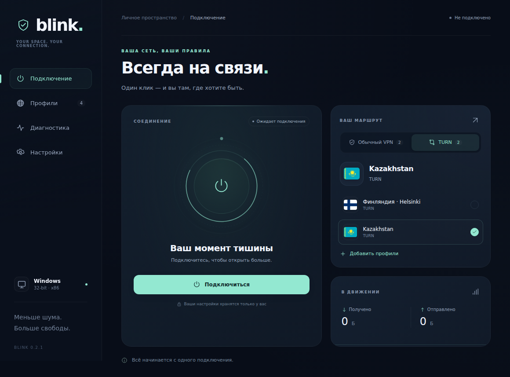
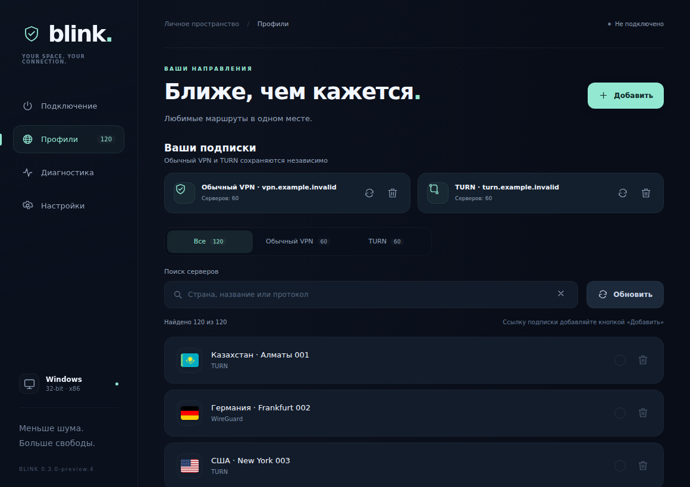

# Blink для Windows

Blink — приложение для подключения к вашим VPN- и TURN-профилям. Подписки обоих типов хранятся вместе; между ними можно переключаться, а нужный сервер — найти по названию или стране.

**Текущая версия: 0.3.0-preview.4.** 18 ноября 2026 пользователь подтвердил работу приложения и подключения на Windows после исправления сетевой настройки. Название preview в архиве и приложении пока сохранено. [Что проверено](docs/validation.md).

## Скачать

| Ваша Windows | Архив |
| --- | --- |
| Windows 10/11, 64 бита | [Скачать Blink x64](https://github.com/remzone/blink_windows/raw/refs/heads/main/testing/0.3.0-preview.4/Blink-Windows-0.3.0-preview.4-x64.zip) |
| Windows 10, 32 бита | [Скачать Blink x86](https://github.com/remzone/blink_windows/raw/refs/heads/main/testing/0.3.0-preview.4/Blink-Windows-0.3.0-preview.4-x86.zip) |

Если не знаете, какой архив выбрать: в параметрах Windows найдите **«Тип системы»**. Для 64-разрядной операционной системы выбирайте **x64**, для 32-разрядной — **x86**. Windows 7/8 не поддерживаются.

[Контрольные суммы SHA-256](https://github.com/remzone/blink_windows/blob/main/testing/0.3.0-preview.4/SHA256SUMS) · [Подробная инструкция для новичков](docs/QUICKSTART.md)

## Первое подключение

Понадобятся интернет и **ссылка на подписку или файл конфигурации от вашего VPN-сервиса**. Blink сам по себе не выдаёт подписку и серверы.

1. Скачайте подходящий ZIP по ссылке выше. Кнопка GitHub **Code → Download ZIP** скачивает исходники; готовое приложение находится по ссылкам в таблице.
2. Нажмите на скачанный архив правой кнопкой мыши → **Извлечь всё**. Откройте полученную папку. `Blink.exe` и `wintun.dll` должны оставаться рядом; запускать приложение прямо из архива не нужно.
3. Запустите **Blink.exe**. Подтвердите запрос Windows на внесение изменений: права администратора нужны для создания сетевого адаптера и настройки подключения.
4. Откройте **Профили → Добавить**, вставьте ссылку подписки и подтвердите импорт. Вместо ссылки можно выбрать файл конфигурации. Вставляйте подписку в окно добавления, а название сервера — в поиск.
5. Выберите сервер в открывшемся списке. Поиск понимает название, страну и протокол. Для большой подписки используйте фильтры **Все / Обычный VPN / TURN**.
6. Откройте **Подключение** и нажмите **Подключиться**. Дождитесь статуса **«Соединение активно»**. Для проверки откройте нужный сайт или воспользуйтесь разделом **Диагностика**.

Если приложение не открывается и сообщает об отсутствии WebView2, установите [Microsoft Edge WebView2 Runtime с сайта Microsoft](https://developer.microsoft.com/en-us/microsoft-edge/webview2/), затем запустите Blink снова. Сборка Blink пока не подписана цифровой подписью издателя.

## Обычный VPN и TURN

- **Обычный VPN** — профили обычного VPN-подключения из вашей подписки.
- **TURN** — профили с дополнительным транспортом TURN, если их предоставляет ваш сервис. Переключатель не превращает обычную подписку в TURN: для этого нужен соответствующий профиль.
- Добавляйте обе подписки через **Профили → Добавить**. Новая подписка сохраняется рядом с существующими.
- Для смены сервера или типа подключения сначала нажмите **Отключиться**, выберите **Обычный VPN** или **TURN**, затем нужный сервер и **Подключиться**.
- Выбор сервера для каждого типа запоминается после перезапуска. Если вкладка пустая, подходящие профили ещё не добавлены.

В **Профилях** у каждой подписки своя карточка и кнопка обновления. Обновление одной подписки не удаляет другую. [Подробнее о подписках](docs/QUICKSTART.md#подписки-и-выбор-сервера).

| Список серверов | Поиск по стране |
| --- | --- |
|  |  |

Скриншоты показывают интерфейс на демонстрационных профилях; адреса и данные пользователей в них не используются.

## Как обновить приложение

Нажмите **Отключиться**, полностью закройте старый Blink, скачайте текущий ZIP и распакуйте его целиком в новую папку. Запускайте `Blink.exe` из новой папки. Подписки и настройки сохраняются в профиле текущего пользователя Windows; повторно добавлять их не требуется.

## Если что-то не получилось

| Проблема | Что сделать |
| --- | --- |
| Нет серверов | Добавьте подписку через **Профили → Добавить**. Проверьте выбранный фильтр и очистите поиск. |
| Не работает импорт | Проверьте, что скопировали ссылку подписки целиком. Срок и доступность подписки уточните у сервиса, который её выдал. |
| Нельзя сменить профиль | Сначала отключитесь. |
| Появилась ручная проверка | Выполните задание внутри Blink и дождитесь продолжения подключения. |
| Подключение завершилось ошибкой | Сохраните текст ошибки и откройте **Диагностика → Открыть папку журнала**. Передайте в поддержку `blink.log` и `blink.log.1`, если второй файл есть. |
| После аварийного закрытия остались проблемы с сетью | Откройте **Настройки → Восстановить сеть**. Если ошибка остаётся, сохраните журнал. |

Журнал находится в `%APPDATA%\Blink\logs`, создаётся автоматически и не отправляется по сети. Ссылки подписок и ключи в него не записываются. Саму ссылку подписки не публикуйте: она даёт доступ к вашим профилям.

## Документация

- [Пошаговая инструкция для новичков](docs/QUICKSTART.md).
- [Готовый текст для публикации или отправки пользователям](docs/ANNOUNCEMENT.md).
- [Техническое руководство: форматы, настройки, журнал, IPv6 и сборка из исходников](docs/technical-guide.md).
- [Изменения](docs/CHANGELOG.md), [проверки](docs/validation.md), [протоколы](docs/protocols.md), [архитектура](docs/architecture.md), [дизайн](docs/UI-DESIGN.md).

Клиент использует общее Go-ядро [Blink iOS](https://github.com/remzone/blink_ios) и [Blink Android](https://github.com/remzone/blink-android). Интеграция Blink — **GPL-3.0-only**, см. [LICENSE](LICENSE). Лицензии зависимостей перечислены в [THIRD-PARTY-NOTICES.md](THIRD-PARTY-NOTICES.md).
