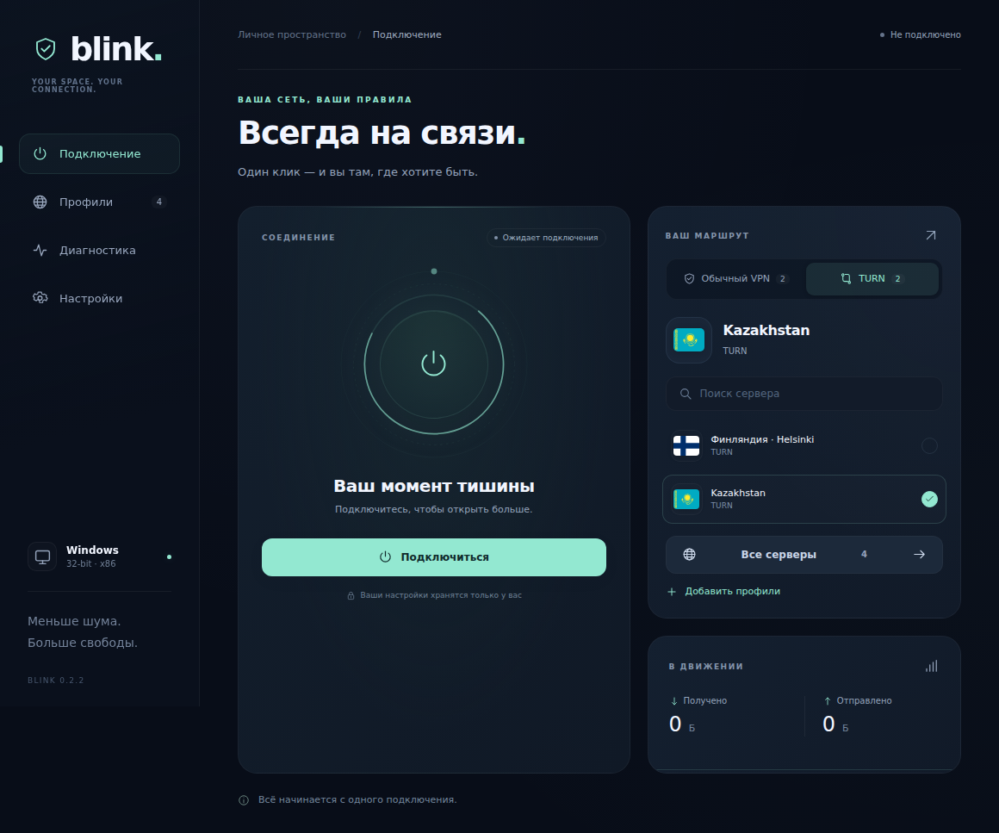
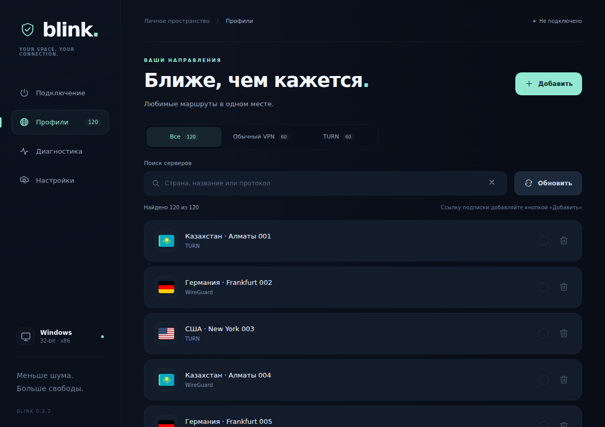
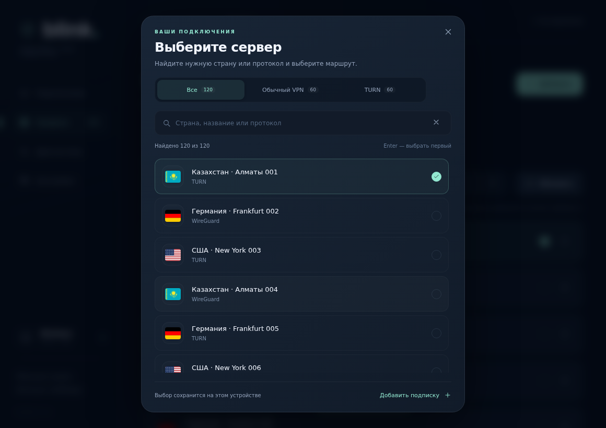
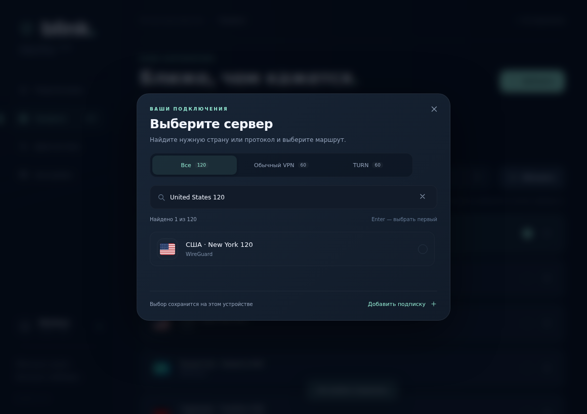

# Дизайн Windows 0.2.2

Интерфейс 0.1.0 был набором стандартных Win32-контролов и визуально не соответствовал Blink. В 0.2.0 он заменён встроенным desktop frontend на Wails/WebView2. Это интерфейс приложения: никакого внешнего сайта или HTTP-сервиса для управления VPN не поднимается.

Источник токенов — `BlinkTheme.swift` в iOS и `BlinkStyle.java` в Android: фон `#080d18`, поверхности `#131d2c`, текст `#f2f6ff`, вторичный текст, мятный `#93e8d1`, голубой `#a8c7ff`. Сохранены мягкие карточки, орбита подключения, компактные SVG-иконки, спокойная типографика и визуальные состояния.

- Главная: переключатель **Обычный VPN / TURN** с количеством серверов, видимый список профилей с SVG-флагами и отметкой выбора, состояние транспорта, реальные пакетные счётчики и график их приращений. Ошибка подключения остаётся под кнопкой, даже после исчезновения toast. Декоративных фиктивных измерений нет.
- Профили: поиск, выделение выбранного профиля, тип backend, вкладки обычного VPN / TURN, добавление через отдельное окно.
- Диагностика: независимые IP/Google/YouTube проверки с человеческим представлением измерений.
- Настройки: отдельные формы TURN и маршрутов; сетевые изменения недоступны во время подключения.
- Ручная проверка: встроенное ручное задание SDK, понятная отмена и повторное открытие; изображение/код для legacy.

Векторы 257 флагов включены локально из `flag-icons` 7.5.0 (MIT), в том числе Казахстан, США и Великобритания. Код определяется по эмодзи, названию страны на русском/английском либо ISO-коду в начале имени. Неизвестная страна показывает нейтральную пиктограмму. Флаги не зависят от поддержки эмодзи Windows и не запрашиваются с CDN. Собственные подписи используют общее название «TURN»; официальный удалённый challenge остаётся страницей своего поставщика. Иконка EXE нарисована из собственного shield mark и включена в нескольких размерах.

Широкое окно использует левую навигацию и две колонки. Компактная раскладка складывает карточки и сохраняет прокрутку; минимальное окно приложения — 760×660 логических пикселей. Кнопки имеют focus-visible, семантические подписи, понятный disabled state; `prefers-reduced-motion` отключает анимации. Профили выводятся через textContent, HTML из подписки не исполняется.

Изображения — Chromium-превью тех же встроенных HTML/CSS/JS с синтетическим backend. Список серверов и данные не являются реальными реквизитами; эти снимки не доказывают работу Windows VPN. Настоящий WebView2 smoke-сценарий сохраняет отдельные screenshots в CI artifacts.

## Выбор и поиск серверов

После импорта открывается отдельное окно с прокручиваемым списком и поиском. Вкладка «Все» исключает ситуацию, когда импортированные серверы скрыты фильтром другого типа. Три фильтра показывают количество профилей. Поиск учитывает страну на двух языках, ISO-код и протокол; видны число результатов и кнопка сброса. Enter выбирает первый доступный результат, Escape закрывает окно, Tab перемещается по элементам.

На главной есть быстрый поиск и кнопка «Все серверы». В библиотеке поле подписано «Поиск серверов»; ссылка, вставленная в него, переносится в форму импорта без автоматического запроса.

