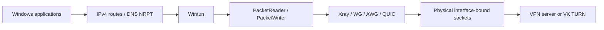

# Архитектура

`cmd/blink` — нативное окно Win32 на одном закреплённом OS-потоке: список профилей, многострочный импорт, системный выбор файла, действия VPN, IP-диагностика и старый формат CAPTCHA. Фоновые операции возвращаются в UI через очередь и `PostMessage`; сетевые запросы не блокируют оконный цикл. Один глобальный named mutex предотвращает одновременный запуск клиентов, меняющих один адаптер.

`internal/client` — переносимая модель профилей и состояния, HTTPS-загрузка с ограничениями, преобразование Vokop v1/v2 в `mobile.VKProfile`. Обычные форматы принимает общий `mobile.ImportProfiles`. Максимум входного документа — 1 МиБ, максимум обычных строк — 1024. Поля Vokop проверяются, дубликаты JSON отклоняются, срок и revision не отключаются. Revision привязан к последней сохранённой ссылке; смена ссылки считается новой подпиской, глобальной защиты после удаления хранилища нет. Список заменяется только после успешного парсинга и записи DPAPI.

`internal/platform` — Windows DPAPI, Wintun через официальный `wireguard/tun`, Windows PowerShell для IP/маршрутов/DNS/Firewall. PowerShell запускается по пути из Windows System Directory, без профиля, с таймаутом 30 секунд. Секреты в командную строку не передаются. IP и префиксы проверяются до формирования скрипта. Wintun загружается по абсолютному пути рядом с EXE.

`native` — снимок общего мобильного ядра: Xray, WG/AWG, QUIC-клиенты, парсеры, VK TURN, geodata и исходные тесты. Оно не зависит от соседних checkout при сборке. Единственное исходное изменение — import/module prefix на Windows-репозиторий. Сравнение снимка описано в provenance.

## Путь пакетов

Вход Wintun читает один worker с сохранением порядка пакетов и вызывает `Engine.Input`. Обратный путь — `PacketWriter.WritePacket` в Wintun. Защита внешних сокетов использует `IP_UNICAST_IF` / `IPV6_UNICAST_IF`: индекс физического IPv4-интерфейса определяется до настройки VPN. Это должно предотвращать рекурсивный уход VPN-сокетов в собственный туннель; проверка на Windows ещё нужна.

## Подключение

1. Проверка администратора, IPv4-параметров, DLL и физического default route.
2. Создание адаптера `Blink` и запуск ядра. Для VK — ожидание TURN/DTLS/smux или соответствующего WG-транспорта; до ready маршруты отсутствуют. Ожидание ограничено пятью минутами, challenge ядра имеет собственный срок.
3. Настройка адресов и DNS интерфейса. Default route превращается в две `/1`, чтобы сохранить исходный physical default route. Более специфичные локальные маршруты остаются доступны.
4. Для полного туннеля — DNS NRPT `.` с DNS профиля и блокировка исходящего IPv6 через Windows Firewall. Для частичного WG применяются AllowedIPs; диагностика следует им и не доказывает полного туннелирования.
5. Отдельная кнопка HTTPS-проверки подтверждает внешний IP. До этого интерфейс показывает готовность туннеля, а не подтверждённый доступ в интернет.

WG ready означает запуск устройства, а не свежий handshake с peer. Счётчики отражают пакетный мост, а не только полезную нагрузку или handshake. Потеря готовности VK после подключения сохраняет маршруты, пока ядро переподключается; остановка ядра и ошибка чтения Wintun инициируют очистку.

## Отключение и авария

Конфигурация и закрытие сериализованы mutex, поэтому отмена не может оставить поздно добавленные маршруты. Ошибка настройки вызывает закрытие туннеля и очистку. При штатном закрытии сначала удаляются DNS/Firewall/маршруты Blink, затем закрываются Wintun и ядро. Если очистка сообщает ошибку, UI остаётся доступен для восстановления.

Аварийное завершение не обеспечивает автоматическую очистку PowerShell-политик: нужен `--recover` или кнопка восстановления. Это приложение без Windows Service и без постоянного kill switch. Во время настройки/снятия маршрутов и до ready физическая сеть доступна. Проверка DNS, IPv6, сна/пробуждения, доменных политик и внешних VPN обязательна перед повседневным использованием.

## Хранение

`%APPDATA%\Blink\profiles.dpapi` содержит весь JSON состояния, зашифрованный Windows DPAPI CurrentUser. Запись выполняется во временный файл, синхронизируется и заменяет предыдущий через `MoveFileEx`. Перенос на другую учётную запись не поддерживается. Защита не распространяется на активную память процесса, содержимое исходного файла и код, запущенный под тем же пользователем. Приложение не пишет профили/URL/CAPTCHA в журналы.

## Официальные API

- [Wintun и подписанные бинарные файлы](https://www.wintun.net/)
- [Windows New-NetFirewallRule](https://learn.microsoft.com/en-us/powershell/module/netsecurity/new-netfirewallrule)
- [Windows Add-DnsClientNrptRule](https://learn.microsoft.com/en-us/powershell/module/dnsclient/add-dnsclientnrptrule)
- [Windows Remove-DnsClientNrptRule](https://learn.microsoft.com/en-us/powershell/module/dnsclient/remove-dnsclientnrptrule)
