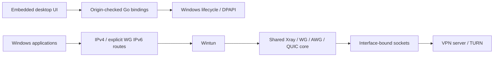

# Архитектура 0.3.0-preview.1

`cmd/blink/main_windows.go` — desktop host Wails 2.17.1/WebView2 и lifecycle/controller. `cmd/blink/ui` — встроенные HTML/CSS/JS, SVG-иконки и закреплённый официальный SDK ручной проверки. Node не нужен для сборки готовых assets. Привилегированные Go bindings разрешены только локальному origin приложения; удалённый CAPTCHA iframe их не получает.

`internal/client` — переносимый импорт, модель и настройки. `internal/platform` — Windows DPAPI, Wintun, PowerShell и защита внешних сокетов. `native` — неизменённый снимок общего ядра iOS/Android с Windows module prefix; исходные native-тесты и лицензии сохранены.

## Мост UI

Frontend получает безопасный Snapshot: имена/типы/индексы профилей, статус, счётчики, настройки без ключей, срок/revision. UUID, конфигурации, приватные ключи и ссылка подписки не возвращаются. Временный challenge URL и CAPTCHA-ответ находятся в отдельном короткоживущем потоке UI. Введённая конфигурация очищается при закрытии импорт-окна.

Все lifecycle-данные защищены mutex; Wails bindings могут исполняться конкурентно. UI получает `blink:state` и первоначальный Snapshot. Подключение можно отменить ещё при подготовке: результат незавершённого старта проверяется до публикации tunnel handle. Закрытие ждёт завершения сетевой операции и очистки.

Browser profile создаётся во временном подкаталоге AppData Blink, не разделяется с Edge/system browser, удаляется при штатном завершении. Оставшиеся после аварии каталоги очищаются на следующем запуске. Браузер всё равно может временно кешировать свой runtime-контент; это не обещание отсутствия всех записей WebView2 на диск.

## Путь пакетов

Физические интерфейсы определяются до маршрутов VPN. `IP_UNICAST_IF` использует сетевой порядок байтов, `IPV6_UNICAST_IF` — порядок хоста; для IPv6 учитывается собственный physical default route. Пакеты Wintun передаются ядру в порядке чтения, обратный путь — через PacketWriter.

Для TURN транспорт должен стать ready до настройки адресов/маршрутов. Обычный WG running означает запуск устройства, а не свежий handshake. UI и отдельная HTTPS-диагностика различают состояние туннеля и результат запроса. После отправки CAPTCHA тот же ID подавляется до нового challenge; post-answer ожидание — 60 секунд.

## Маршрутизация

Vokop v3 и `routing` преобразуются в `mobile.RoutingPolicy`, строго валидируются и передаются соответствующий метод общего ядра. Личные включения/исключения объединяются с серверными. Для all+exclusions формируется selected IPv4-политика с двумя `/1`, чтобы исключения не игнорировались native all-mode.

Полные OS routes также задаются двумя `/1` каждого семейства с сохранением физического default route. Более специфичные локальные маршруты продолжают действовать. Full IPv4 без явного IPv6-адреса добавляет правило Firewall для IPv6; полный профиль WG с явным IPv6 его не блокирует. NRPT задаёт DNS профиля для системного резолвера. Выборочный маршрутизатор ядра использует IPv4; IPv6+selected отклоняется.

## Очистка и хранение

Конфигурация и Close сериализованы отдельным mutex. Очистка пытается выполнить каждую независимую операцию, даже если другая заблокирована политикой Windows. Она затрагивает только собственное NRPT, Firewall `Blink-IPv6` и интерфейс `Blink`. Ошибка очистки оставляет приложение доступным для Recover. Авария требует повторного запуска/`--recover`; постоянного kill switch и службы нет.

Состояние зашифровано DPAPI CurrentUser, записывается через временный файл, sync и MoveFileEx replacement. Формат 0.1.0 совместим: новые поля необязательны, старые настройки получают defaults. Перенос ciphertext в другую учётную запись не поддерживается.

## x86

Отдельная CGO-free сборка `GOARCH=386`, собственный manifest resource и x86 DLL Wintun. Структуры Windows API/DPAPI используются из x/sys, WebView2 — через закреплённую версию go-webview2 с x86 bindings. На x64 Windows тест x86 исполняется в WOW64; он не заменяет проверку отдельной 32-битной ОС.

Официальные API: [Wintun](https://www.wintun.net/), [Wails options](https://v2.wails.io/docs/reference/options/), [NRPT](https://learn.microsoft.com/en-us/powershell/module/dnsclient/add-dnsclientnrptrule), [Firewall](https://learn.microsoft.com/en-us/powershell/module/netsecurity/new-netfirewallrule), [Playwright WebView2](https://playwright.dev/docs/webview2).

## Определение исходного интерфейса (0.2.1)

`GetIPForwardTable2` перечисляет default routes отдельно для IPv4/IPv6. `GetIfEntry2` и `GetIpInterfaceEntry` проверяют активность адаптера, имя и метрику. Кандидаты без индекса, отключённые и собственный Blink исключаются. Сравнение использует сумму route metric + interface metric в uint64; при равенстве — меньший индекс. При отсутствии IPv4-маршрута подключение останавливается с понятным сообщением до создания туннеля. Успешный IPv6 lookup используется для защиты IPv6-сокетов, при отсутствии — прежний fallback на IPv4 index.

В 0.2.0 индекс разбирался через `fmt.Sscan` из `powershell.exe -EncodedCommand` + `CombinedOutput`. Такой вывод может включать CLIXML/progress из stderr или зависеть от console encoding. Скриншот ошибки подтверждал сбой разбора, но конкретный stdout/stderr того компьютера не получен. Новый путь вообще не читает текст консоли. Оставшийся PowerShell настраивает/очищает только сетевые правила; progress отключён, stdout отделён от stderr.

Описание структуры и метрик: [Microsoft MIB_IPFORWARD_ROW2](https://learn.microsoft.com/en-us/windows/win32/api/netioapi/ns-netioapi-mib_ipforward_row2). Windows API не проверен на пользовательском устройстве в этой среде; для него добавлены read-only Windows tests.

## Источники и миграция

`State.Sources` хранит несколько источников, `Profile.SourceID` задаёт владение. `MergeImport` создаёт новое состояние, обновляя только исходный URL; все другие источники сохраняются. `MinimumRevision` вычисляется для конкретного источника. Идентификаторы источников — непрозрачные хеши ссылок, сами ссылки остаются только внутри DPAPI. Стабильный panel ID сохраняет выбор TURN-профиля при обновлении срока и параметров. `Selections` хранит ID последнего сервера каждого типа. Старые поля single-source читаются и мигрируют при запуске.

Snapshot передаёт ID/имя/тип/счётчик источника и возможность обновления; URL и конфигурации не публикуются. Обновить можно выбранный источник либо конкретную карточку. Добавление новой подписки не очищает другую.

## Отмена и диагностические этапы

`platform.awaitStart` изолирует синхронный старт Windows: результат доставляется через канал, ожидание ограничивается context. При отмене поздно созданный туннель очищается worker-ом. Gate удерживается до завершения очистки, исключая пересечение старого старта с новым. Непрерываемый вызов драйвера остаётся внутри worker до возврата Windows; новый старт в это время получает понятную ошибку.

Перед запуском ядра удаляются только оставшиеся правила Blink из прежней аварийной сессии. PowerShell получает контекст операции, ограничен 30 секундами и прекращается при отмене. Старт драйвера/ядра ограничен 45 секундами. Monitor ограничивает установление/восстановление TURN 90 секундами, показывает ручной challenge, обрабатывает собственный срок и 60-секундное ожидание ответа.

`disconnect(expected)` проверяет идентичность туннеля под mutex. Трасса ошибки фиксируется до снятия busy, поэтому старая попытка не может отменить или переписать новую. После успеха очистки состояние становится disconnected; при ошибке остаётся доступно восстановление.

`ConnectionTrace` принимает только известные события общего ядра и разрешённые числовые поля. Кольцо ограничено 100 событиями, raw-тексты ядра/профили/URL в него не копируются. Snapshot копирует event slice под mutex. Экспорт отчёта сериализует отдельную фиксированную структуру, а не весь State/View; отправки по сети нет.
